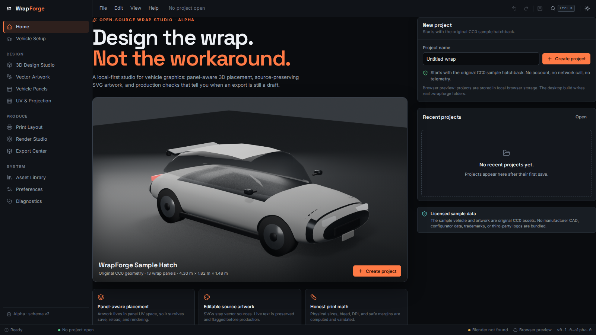
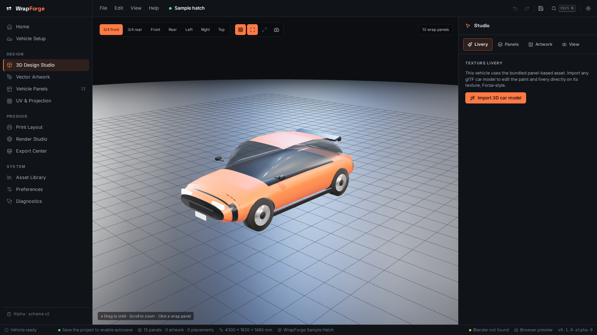
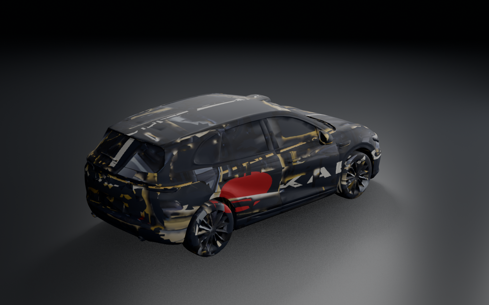
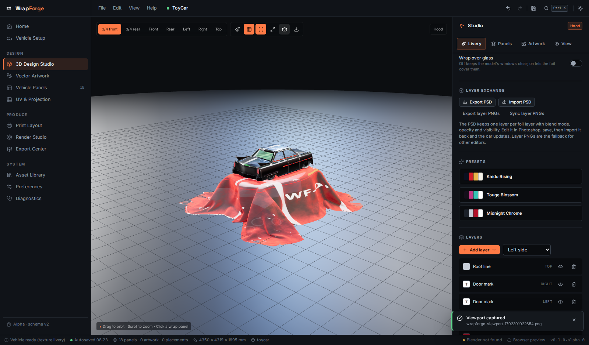

# WrapForge

**Open-source vehicle wrap design studio.** Panel-aware 3D placement, editable
artwork, managed Blender rendering, and production checks that distinguish a
draft from output the configured rules consider print-ready.



The 3D studio with the bundled CC0 sample vehicle:



An imported glTF car with auto-detected panels and a projected
Japanese-tuning-inspired livery, rendered by the bundled Blender pipeline:



A second model with no semantic mesh names, imported unchanged and rescaled from
toy size to 4.35 m:



*Vehicle model: "Leapmotor-b05" by UZBEK 3D (Sketchfab), CC-BY-4.0, supplied by
the user for testing and not redistributed with WrapForge. The livery is an
original WrapForge preset.*

> **Status: alpha (0.1.0-alpha.0).** WrapForge is not production-ready for
> commercial print. The sample vehicle is original stylized geometry, not a
> manufacturer-accurate model, and imported models are normalised by heuristic.
> Read [KNOWN_LIMITATIONS.md](KNOWN_LIMITATIONS.md) before using any output.

## Why this exists

Vehicle wrap work is split between vector design tools, generic 3D viewers, and
installer-facing print preparation. WrapForge puts those steps in one local
desktop application:

- Artwork is placed **in panel UV space**, not as an unanchored texture.
- Any car glTF can be imported: panels are detected automatically, the paint can
  be edited **directly on the body texture**, Forza-style, with brushwork,
  layers, and projected stripes that follow the panels, and a wrong region can be
  renamed, merged, or removed.
- SVG sources stay vector; live text is preserved and flagged before production.
- Physical output dimensions, bleed, safe margins, and DPI are computed from
  asset metadata and validated.
- Blender is an internal rendering engine behind a managed subprocess, not a
  tool the designer must operate.
- Nothing is uploaded. There is no account, telemetry, or cloud dependency.

## What actually works today

Verified in this repository on Ubuntu 26.04 with Node 22, Rust 1.93, and Blender
5.2.0 LTS (Flatpak):

| Area | Status |
|---|---|
| Tauri 2 desktop shell | Builds and launches; create → save → reopen and a real Blender render verified through WebDriver |
| Project create/save/load | Project JSON schema, migrations, atomic writes, recent projects; desktop IPC exercised end to end |
| Browser fallback | Save/load/reopen verified by Playwright |
| Sample vehicle | Original CC0 glTF with 13 wrap panels and planar outer-face UVs |
| 3D viewport | three.js viewport, orbit/pan/zoom, panel picking, paint, textures, isolation, graceful no-WebGL message |
| Vehicle import | Any self-contained glTF: unit/orientation normalisation, geometric panel detection including windows, confidence per panel, and rename/merge/remove corrections |
| Glass handling | Windscreen, rear screen and side glass are detected as panels; the livery is masked off them unless "Wrap over glass" is on |
| Layer exchange | Layered PSD export/import with blend modes and visibility, plus a per-layer PNG folder with a manifest |
| AI access | Built-in MCP server: create/open projects, edit panels, layers and finishes from an MCP client |
| Texture livery | Brush/eraser painting straight onto the body texture, layer stack with blend modes, projected decal planes rasterised through the model UVs, three original presets, PNG atlas export |
| Transparency | Alpha brushwork, per-layer opacity and blend modes, transparent PNG export, transparent render background |
| Artwork | SVG import (sanitized), raster import, live text, source-preserving placement |
| Placement editing | UV position, width, rotation, opacity, visibility, lock, undo/redo |
| Print planning | Physical sizes, bleed, DPI, safe margins, raster limits, validation |
| Panel export | PNG and SVG panel documents plus a JSON manifest, draft/ready labelling |
| Blender rendering | Discovery (including Flatpak), headless Eevee render, progress, cancellation, metadata; 1600×1000 render produced from the desktop UI |
| Diagnostics | Blender detection/probe, environment, redacted log bundle |
| i18n | English and German shell/navigation translations; infrastructure for the rest |

## What is not implemented

- CMYK, ICC profiles, spot colours, and printer-specific ink limits.
- Geometric unfolding of curved 3D panels into flat print patterns.
- Camera projection and surface-conforming (shrink-wrap) projection.
- Manual merge/split of auto-detected panels.
- Draco/KTX2-compressed glTF import.
- User-installed asset packs, duplicate detection, and a community library UI.
- Persistent render queues and batch camera renders.
- Windows/macOS builds, signing, notarization, and an auto-updater.
- Committed CI automation for the desktop IPC path. The path was exercised
  manually with `tauri-driver` + WebKitWebDriver and is documented in
  [docs/TESTING.md](docs/TESTING.md), but a repeatable CI harness is still
  missing.

See [TASKS.md](TASKS.md), [PROGRESS.md](PROGRESS.md), and
[KNOWN_LIMITATIONS.md](KNOWN_LIMITATIONS.md).

## Requirements

- **Node.js 22+** and npm
- **Rust 1.77+** with Cargo
- **Tauri 2 Linux dependencies** (Ubuntu/Kubuntu example below)
- **Blender 4.2+** for offline rendering. Blender 5.2 LTS is the tested version.
  The application remains usable without Blender; rendering and capability
  diagnostics are unavailable.
- **Python 3.11+** only for the backend test suite and CLI

### Linux (Ubuntu/Kubuntu)

```bash
sudo apt-get install build-essential pkg-config libssl-dev libgtk-3-dev \
  libwebkit2gtk-4.1-dev libjavascriptcoregtk-4.1-dev libsoup-3.0-dev \
  libayatana-appindicator3-dev librsvg2-dev patchelf
```

Blender may be installed normally, via Snap, or via Flatpak. WrapForge detects
`blender` on `PATH`, common install paths, and the Flatpak app
`org.blender.Blender`.

## Quick start

```bash
git clone <your-fork-url> wrapforge
cd wrapforge
npm install
npm run tauri dev
```

The first build compiles the Rust shell and may take several minutes.

### Browser development only

```bash
npm install
npm run dev
```

The browser build is a functional preview using local browser storage for
projects. Blender rendering and native file dialogs are desktop-only.

## Build

```bash
npm run build                    # frontend production bundle
npm run tauri build -- --no-bundle   # desktop binary, no installers
npm run tauri build              # platform installers
```

Only the Linux debug binary has been built in this repository so far. Do not
assume Windows/macOS installers or signed releases exist (see
[docs/RELEASE_PROCESS.md](docs/RELEASE_PROCESS.md)).

## Tests

Actual results from the verified environment:

| Suite | Command | Result |
|---|---|---|
| Frontend unit | `npm test` | **53 passed** |
| Frontend typecheck | `npm run typecheck` | **passed** |
| Lint | `npm run lint` | **passed** |
| Frontend build | `npm run build` | **passed** |
| Backend Python | `cd backend && .venv/bin/pytest -q` | **52 passed** (incl. Blender integration) |
| Rust unit | `cd src-tauri && cargo test` | **11 passed** |
| Browser E2E | `npx playwright test` | **1 passed** |
| Tauri build | `npm run tauri build -- --debug --no-bundle` | **passed** |
| Desktop launch | run built binary | **window rendered, screenshot captured** |

Blender-dependent tests skip explicitly when Blender is unavailable. Skipped
tests are not reported as passed; CI separates them.

## Architecture at a glance

```
React + TypeScript UI (Vite, Zustand, Zod)
        │  typed invoke() commands / events
        ▼
Tauri 2 Rust shell ── project storage, path safety, Blender process manager
        │
        ├── Blender headless (Eevee/Cycles) ── deterministic render script
        │
        └── Python backend package ── validation, print planning, JSON CLI
```

The design document is independent of Blender. See
[ARCHITECTURE.md](ARCHITECTURE.md) and [DECISIONS.md](DECISIONS.md).

## Repository layout

```
src/                 React application (views, components, project model)
src-tauri/           Tauri shell, Rust commands, Blender render script
backend/             Python backend package, CLI, pytest suite
assets/sample-vehicle/  Original CC0 vehicle asset and manifest
assets/sample-artwork/  Original CC0 sample SVGs
docs/                User, developer, print, asset, testing, privacy docs
tools/               Procedural sample-vehicle generator
e2e/                 Playwright browser workflow
.github/             CI, release workflow, issue/PR templates
```

## Sample assets and licensing

- Application code: **Apache-2.0** (see [LICENSE](LICENSE)).
- Sample vehicle and sample artwork: **CC0-1.0**, generated for this project.
- Third-party dependencies retain their own licenses; see
  [THIRD_PARTY_NOTICES.md](THIRD_PARTY_NOTICES.md).
- No manufacturer CAD, configurator data, third-party logos, or commercial
  fonts are bundled.
- Blender is an external GPL-3.0 dependency and is not redistributed here.

## Documentation

- [User guide](docs/USER_GUIDE.md)
- [MCP server](docs/MCP.md)
- [Developer guide](docs/DEVELOPER_GUIDE.md)
- [Vehicle assets](docs/VEHICLE_ASSETS.md)
- [Print workflow](docs/PRINT_WORKFLOW.md)
- [Project format](docs/PROJECT_FORMAT.md)
- [Testing](docs/TESTING.md)
- [Release process](docs/RELEASE_PROCESS.md)
- [Privacy](docs/PRIVACY.md)
- [Threat model](THREAT_MODEL.md)
- [Known limitations](KNOWN_LIMITATIONS.md)

## Contributing

Read [CONTRIBUTING.md](CONTRIBUTING.md) and
[CODE_OF_CONDUCT.md](CODE_OF_CONDUCT.md). Security issues should follow
[SECURITY.md](SECURITY.md).

## License

Copyright WrapForge contributors. Licensed under the Apache License, Version
2.0. See [LICENSE](LICENSE) and [NOTICE](NOTICE).
